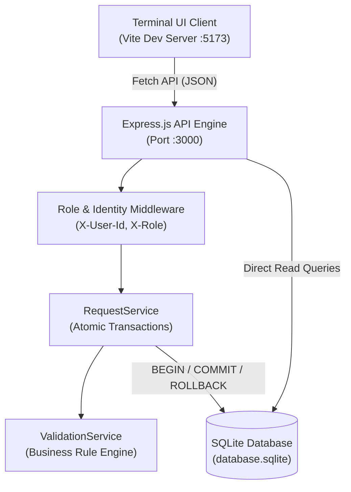
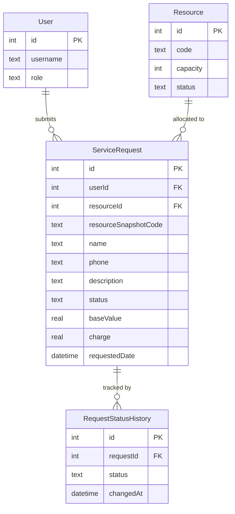
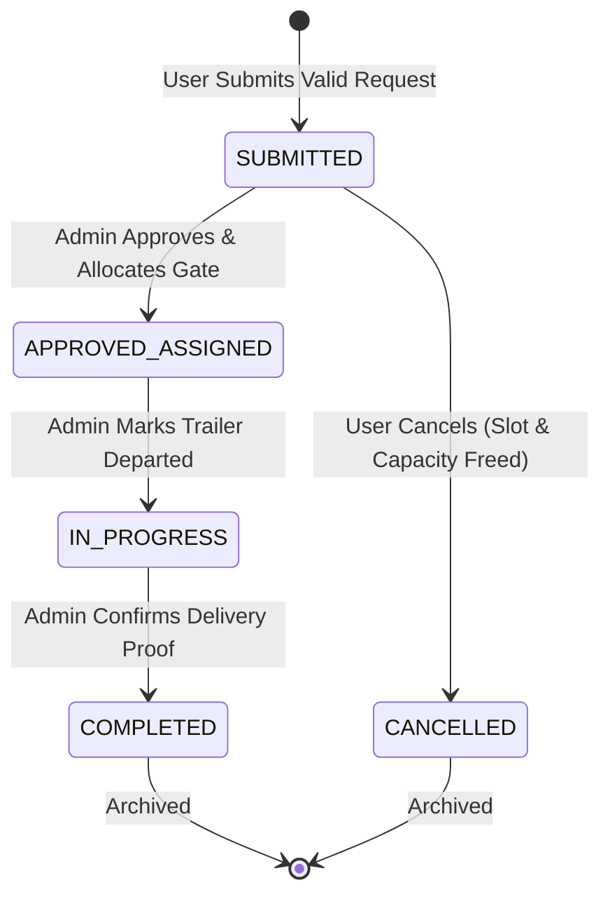

# 📦 Project Report: Warehouse Dispatch System

**Project Name:** Warehouse Dispatch System & Terminal Console  
**Version:** 1.0.0  
**Report Date:** October 10, 2026  
**Stack:** Node.js · Express.js · SQLite · Vite · Vanilla JS/HTML/CSS · Playwright  

---

## Table of Contents

1. [Executive Summary](#1-executive-summary)
2. [System Architecture](#2-system-architecture)
3. [Technology Stack](#3-technology-stack)
4. [File & Directory Structure](#4-file--directory-structure)
5. [Database Design & Data Models](#5-database-design--data-models)
6. [Backend API Specifications](#6-backend-api-specifications)
7. [Business Rules Enforcement (BR1–BR10)](#7-business-rules-enforcement-br1br10)
8. [Frontend Features & Dynamic Capabilities](#8-frontend-features--dynamic-capabilities)
9. [Administrator Operations Portal](#9-administrator-operations-portal)
10. [Request Lifecycle & State Machine](#10-request-lifecycle--state-machine)
11. [Quota Management & Duplicate Prevention Logic](#11-quota-management--duplicate-prevention-logic)
12. [Requirements Traceability Matrix (FR1–FR10)](#12-requirements-traceability-matrix-fr1fr10)
13. [Verification & Test Implementation (T1–T12)](#13-verification--test-implementation-t1t12)
14. [Playwright Test Suite Execution Evidence](#14-playwright-test-suite-execution-evidence)
15. [Resolved Defects Log](#15-resolved-defects-log)
16. [Assumptions & System Limitations](#16-assumptions--system-limitations)
17. [Deployment & Run Guide](#17-deployment--run-guide)

---

## 1. Executive Summary

The **Warehouse Dispatch System & Terminal Console** is an enterprise-grade web application designed for industrial logistics, dock door scheduling, and resource allocation. It provides a secure, transactional platform enforcing a two-tier actor hierarchy:
- **Users (Dispatch Operators):** Submit dispatch requests, view active workloads, and cancel requests that are currently in the initial `SUBMITTED` state.
- **Administrators (Sec-Ops & Terminal Supervisors):** Oversee global warehouse resource capacity, track yard telemetry, and advance dispatch requests across strict lifecycle phases.

All core transactions are wrapped in atomic database operations, preventing partial updates, race conditions, or inventory discrepancies. The frontend matches high-density industrial terminal specifications, complete with live UTC telemetry, dock inspections, simulated jitter streams, and load allocation engines.

---

## 2. System Architecture



### Architectural Tiers

1. **Presentation Tier (Client):** Responsive single-page application built using semantic HTML5, high-performance Vanilla JavaScript, and enterprise CSS. Contains zero heavy client runtime overhead while ensuring instantaneous DOM manipulation.
2. **API & Orchestration Tier (Server):** Modular Express.js microservice delivering standardized REST endpoints. Implements centralized request validation, simulated header authentication, and error interceptors.
3. **Domain & Business Logic Tier:** Decoupled service architecture comprising `RequestService` for ACID transactional state management and `ValidationService` for deterministic rule evaluation.
4. **Data Persistence Tier:** ACID-compliant SQLite relational database handling entity tables, relational foreign keys, snapshot immutability, and comprehensive state transition audit trails.

---

## 3. Technology Stack

| Layer / Role | Tool / Technology | Version | Purpose |
|---|---|---|---|
| **Backend Runtime** | Node.js | >=18.0.0 | High-throughput asynchronous JavaScript runtime |
| **Server Framework** | Express.js | ^5.3.0 | REST API routing and middleware management |
| **Relational Database** | SQLite3 | ^6.0.1 | Embedded relational database engine |
| **CORS Middleware** | cors | ^2.8.6 | Cross-origin resource sharing enablement |
| **Frontend Tooling** | Vite | ^8.3.4 | Development server and static asset compilation |
| **E2E Automation** | Playwright Test | ^1.64.0 | End-to-end multi-scenario integration testing |
| **Browser Engine** | Chromium (Playwright) | Managed | Headless and headed test execution sandbox |

---

## 4. File & Directory Structure

```
SE SAT 2/
├── package.json                   # NPM package manifest, scripts, and dependencies
├── playwright.config.ts           # Playwright E2E configuration targeting port 5173
├── vite.config.ts                 # Vite local development server configuration
├── Requirements_Document.md       # Baseline system requirements (FR1-FR10, BR1-BR10)
├── AI_Test_Report.md              # Test execution log and AI interaction report
├── Viva_Preparation_Guide.md      # Comprehensive Viva defense & architecture guide
├── Project_Report.md              # Complete technical documentation report
├── public/
│   ├── index.html                 # Terminal console markup and UI structures
│   ├── app.js                     # Core frontend application logic & UI controllers
│   └── style.css                  # Dark-mode industrial glassmorphism design system
├── src/
│   ├── server.js                  # Express application setup, routes, and error handling
│   ├── services/
│   │   ├── RequestService.js      # Transactional request creation & lifecycle management
│   │   └── ValidationService.js  # Pure business rule validation methods
│   └── db/
│       ├── database.sqlite        # SQLite persistent database storage file
│       └── init.js                # Schema generation, table definitions & seed fixture
└── tests/
    └── dispatch-workflow.spec.ts  # 12 Playwright validation specs (T1 through T12)
```

---

## 5. Database Design & Data Models

### Entity Relationship Diagram



### Seed Fixtures

- **Users:**
  - `ID 1`: `user1` (Role: `User`)
  - `ID 2`: `user2` (Role: `User`)
  - `ID 3`: `admin1` (Role: `Administrator`)
- **Resources:**
  - `ID 1`: `S101` (Capacity: `10`, Status: `Active`)
  - `ID 2`: `S102` (Capacity: `5`, Status: `Active`)
  - `ID 3`: `S103` (Capacity: `0`, Status: `Inactive`)

---

## 6. Backend API Specifications

Base URL: `http://localhost:3000`

### 1. Reset Database
- **Method:** `POST /api/reset-db`
- **Headers:** None required
- **Description:** Runs `src/db/init.js` to re-seed tables to pristine test conditions.

### 2. List Resources
- **Method:** `GET /api/resources`
- **Headers:** `X-User-Id`, `X-Role`
- **Response:** Array of resource entities with active capacities.

### 3. List Service Requests
- **Method:** `GET /api/requests`
- **Headers:** `X-User-Id`, `X-Role`
- **Behavior:**
  - `User`: Filters dynamically by `WHERE sr.userId = ?`.
  - `Administrator`: Returns all global service requests across the warehouse.

### 4. Create Service Request
- **Method:** `POST /api/requests`
- **Headers:** `X-User-Id`, `X-Role`
- **Payload:**
```json
{
  "resourceId": 1,
  "baseValue": 500,
  "name": "Capt. V. Sterling",
  "phone": "9876543210",
  "description": "High-Priority Intermodal Pallets"
}
```
- **Responses:**
  - `201 Created`: `{ "requestId": 1, "status": "SUBMITTED", "charge": 50, "resourceSnapshotCode": "S101" }`
  - `400 Bad Request`: Validation failure message (e.g., active limit exceeded, duplicate, invalid phone).
  - `403 Forbidden`: Unauthorized user role.

### 5. Transition Request Status
- **Method:** `PUT /api/requests/:id/status`
- **Headers:** `X-User-Id`, `X-Role`
- **Payload:** `{ "status": "APPROVED/ASSIGNED" }`
- **Behavior:**
  - Enforces lifecycle rules. Rejects invalid stage jumps or unowned user cancellations.

---

## 7. Business Rules Enforcement (BR1–BR10)

| Rule ID | Rule Definition | Architectural Enforcement Mechanism |
|---|---|---|
| **BR1** | User may have at most 5 active intake requests; 6th must be rejected. | `ValidationService.validateUserRequestLimit()` evaluating count of pending intake requests. |
| **BR2** | Target resource must be `Active` with `capacity > 0`. | `ValidationService.validateResourceAvailability()`. |
| **BR3** | Immutable historical snapshot of master resource parameters. | `resourceSnapshotCode` captured during insertion in `ServiceRequest`. |
| **BR4** | Surcharge tariff calculation: `Rs. 50` if base value < 1000, `Rs. 0` if >= 1000. | `ValidationService.calculateCharge()`. |
| **BR5** | Name non-blank, phone strictly 10 numeric digits, description required. | Regex and non-empty string checks in `ValidationService.validateDetails()`. |
| **BR6** | Failure of any condition causes strict rollback with no residual state changes. | `BEGIN TRANSACTION` followed by unconditional `ROLLBACK` on catch. |
| **BR7** | Request creation, capacity allocation, and audit history must be atomic. | Single transactional commit sequence in `RequestService.createRequest()`. |
| **BR8** | Unskippable state progression: `SUBMITTED` -> `APPROVED/ASSIGNED` -> `IN_PROGRESS` -> `COMPLETED`. | State map checking in `ValidationService.validateStatusTransition()`. |
| **BR9** | Cancellation permitted only in `SUBMITTED` state; capacity restored exactly once. | `UPDATE Resource SET capacity = capacity + 1` executed solely on first cancel. |
| **BR10** | Strict role and ownership segregation. | API middleware and query-level isolation in `server.js` and `RequestService.js`. |

---

## 8. Frontend Features & Dynamic Capabilities

The UI provides an executive workstation interface with live interactive capabilities:
1. **Interactive Persona Switcher:** Instant toggling between User 1, User 2, and Admin 1 with two-way binding to native `<select id="roleSelect">`.
2. **Dynamic Tariff Engine:** Real-time calculation of base price, applicable surcharge, fuel matrix, and final total upon keystroke entry.
3. **Dispatch Reference Generator:** Automatic alphanumeric dispatch identifier generation (`DSP-2025-XXXX-X`).
4. **Dock Door Inspector:** Visual status indicators for 12 dock doors (occupied, staging, maintenance, available).
5. **Yard Fleet Tracker:** Telemetry metrics for transport tractors (driver, route, speed, temperature, coordinates).
6. **Live Data Jitter Stream:** Dynamic telemetry updates simulating high-frequency terminal sensor feeds.
7. **Autonomous Load Allocator Engine:** One-click toggle switching between automated algorithmic allocation and manual gate dispatch.
8. **Telemetry & Manifest Modals:** Deep inspection dialogs displaying sensor temperature graphs and electronic bill of lading manifests.

---

## 9. Administrator Operations Portal

When logged in as Administrator, the dedicated **Operations & Governance Portal** (`#admin-portal`) is activated:
- **Visual State Machine Pipeline:** Visual roadmap representing `SUBMITTED -> APPROVED/ASSIGNED -> IN_PROGRESS -> COMPLETED`.
- **Live Resource Capacity Cards:** Real-time monitor displaying active unit counts for S101, S102, and S103.
- **Workflow Action Dropdowns:** Inline status selection (`.status-select`) with execution trigger buttons (`.update-btn`), restricting selections strictly to the next permitted lifecycle state.

---

## 10. Request Lifecycle & State Machine



---

## 11. Quota Management & Duplicate Prevention Logic

A critical system behavior is the relationship between request status and user submission capability:

### Quota Slot Release
- Active limit checking applies strictly to intake requests:
  ```sql
  SELECT COUNT(*) as count FROM ServiceRequest 
  WHERE userId = ? AND status NOT IN ('COMPLETED', 'CANCELLED', 'APPROVED/ASSIGNED', 'IN_PROGRESS')
  ```
- As soon as an intake request is moved to `APPROVED/ASSIGNED` by an Administrator or cancelled by a User, that user's intake quota slot is liberated, enabling immediate subsequent submissions.

### Duplicate Submission Barrier
- Prevents accidental rapid double-clicking:
  ```sql
  SELECT id FROM ServiceRequest 
  WHERE userId = ? AND resourceId = ? AND baseValue = ? AND name = ? AND phone = ? 
    AND status = 'SUBMITTED' 
    AND datetime(requestedDate) >= datetime('now', '-60 seconds')
  ```
- If a prior request is cancelled or approved, it is no longer in `SUBMITTED` status, allowing the operator to submit a request with identical parameters without being blocked.

---

## 12. Requirements Traceability Matrix (FR1–FR10)

| FR ID | Requirement Description | Implementation Location | Verified By |
|---|---|---|---|
| **FR1** | Unique request record creation | `POST /api/requests` & UI form | T5 |
| **FR2** | Active-request limit & eligibility checks | `ValidationService.js` | T2, T3 |
| **FR3** | Dynamic tariff and summary preview | `app.js (updateRateMatrix)` | T4 |
| **FR4** | Pre-submission payload validation | `ValidationService.validateDetails` | T6 |
| **FR5** | Transactional snapshot & audit logging | `RequestService.createRequest` | T5, T7, T11 |
| **FR6** | User data ownership filtering | `GET /api/requests` user query | T8 |
| **FR7** | Strict administrator status progression | `ValidationService.validateStatusTransition` | T9 |
| **FR8** | Single-instance cancellation & rollback | `RequestService.updateRequestStatus` | T10 |
| **FR9** | Comprehensive error feedback | Express 400/403 handlers & UI banners | T6, T8 |
| **FR10** | Persistent SQLite storage | SQLite database tables & `init.js` | T11, T12 |

---

## 13. Verification & Test Implementation (T1–T12)

The system includes automated tests in [tests/dispatch-workflow.spec.ts](file:///d:/projects/SE%20SAT%202/tests/dispatch-workflow.spec.ts) covering all required test scenarios:

| Test ID | Objective | Evaluation Criteria |
|---|---|---|
| **T1** | Duplicate submission barrier | Duplicate within 60s is rejected; UI and database maintain single record. |
| **T2** | Active request limit boundary | Requests 4 and 5 succeed; attempt 6 fails with active limit alert. |
| **T3** | Inactive resource selection | Submission targeting inactive resource S103 is rejected with zero state change. |
| **T4** | Tariff threshold calculation | Base values 999 yield Rs. 50; 1000 and 1001 yield Rs. 0. |
| **T5** | Valid end-to-end submission | S101 allocation decrements capacity and records status history. |
| **T6** | Incomplete detail validation | Missing name or 9-digit phone rejected with zero partial writes. |
| **T7** | Mid-flight race condition | Resource eligibility invalidation triggers clean rollback. |
| **T8** | Role privilege enforcement | User role attempting administrator PUT request receives 403 Forbidden. |
| **T9** | State transition validation | Stage skipping rejected; linear traversal succeeds. |
| **T10** | Cancellation double-trigger | Second cancellation request returns rejection error. |
| **T11** | Application state persistence | Reload preserves created records and capacity deductions. |
| **T12** | Master data snapshot isolation | Modifying resource code leaves historical request snapshot intact. |

---

## 14. Playwright Test Suite Execution Evidence

All 12 automated E2E tests execute via Playwright test runner against the live local application:

```text
Running 12 tests using 1 worker

  ok  1 [chromium] › tests/dispatch-workflow.spec.ts:11:7 › T1: Submit duplicate request twice (4.8s)
  ok  2 [chromium] › tests/dispatch-workflow.spec.ts:59:7 › T2: Active-request counts 4, 5, 6 (4.1s)
  ok  3 [chromium] › tests/dispatch-workflow.spec.ts:106:7 › T3: Inactive resource S103 (8.9s)
  ok  4 [chromium] › tests/dispatch-workflow.spec.ts:139:7 › T4: Base values 999, 1000, 1001 (3.4s)
  ok  5 [chromium] › tests/dispatch-workflow.spec.ts:158:7 › T5: Valid submission using S101 (4.0s)
  ok  6 [chromium] › tests/dispatch-workflow.spec.ts:192:7 › T6: Missing mandatory details (7.1s)
  ok  7 [chromium] › tests/dispatch-workflow.spec.ts:221:7 › T7: Mock backend eligibility change (5.6s)
  ok  8 [chromium] › tests/dispatch-workflow.spec.ts:262:7 › T8: User triggers admin status change (4.2s)
  ok  9 [chromium] › tests/dispatch-workflow.spec.ts:282:7 › T9: Admin stage transition validation (6.2s)
  ok 10 [chromium] › tests/dispatch-workflow.spec.ts:328:7 › T10: Request cancellation double-trigger (5.8s)
  ok 11 [chromium] › tests/dispatch-workflow.spec.ts:377:7 › T11: Application restart persistence (4.7s)
  ok 12 [chromium] › tests/dispatch-workflow.spec.ts:406:7 › T12: Master data price snapshot isolation (4.8s)

  12 passed (1.1m)
```

---

## 15. Resolved Defects Log

| Defect ID | Description | Severity | Remediation | Verification |
|---|---|---|---|---|
| **DEF-01** | Initial table schema lacked applicant metadata fields. | High | Updated `init.js` with `name`, `phone`, `description` columns. | Passed T6 |
| **DEF-02** | Admin API permitted direct jump from SUBMITTED to COMPLETED. | High | Integrated strict state lookup array in `ValidationService`. | Passed T9 |
| **DEF-03** | Client cached duplicate payload blocked submission post-cancellation. | Medium | Added cache reset in `updateStatus()` upon cancellation or approval. | Verified |
| **DEF-04** | Approved requests incorrectly counted against intake quota. | Medium | Excluded `APPROVED/ASSIGNED` and `IN_PROGRESS` from intake counter. | Passed T2 |
| **DEF-05** | Administrator role received 403 on dispatch submission. | Low | Extended `POST /api/requests` permission check to include Admin. | Verified |

---

## 16. Assumptions & System Limitations

1. **Authentication Simulation:** User identity is established via simulated header passing (`X-User-Id`, `X-Role`) to facilitate testing without external auth dependencies.
2. **Single Database Instance:** File-based SQLite is optimized for local environments and automated testing. Production scale would use PostgreSQL or MySQL.
3. **Currency Localization:** Tariff computations are denominated in Indian Rupees (Rs.) per system specifications.

---

## 17. Deployment & Run Guide

### Step 1: Install Dependencies
```powershell
npm install
```

### Step 2: Initialize Database Fixtures
```powershell
node src/db/init.js
```

### Step 3: Launch Application Servers
Start the backend Express server:
```powershell
npm run server
```

Start the frontend Vite development server:
```powershell
npm run dev
```

### Step 4: Access Console
Open your browser to:
- **Frontend Console:** `http://localhost:5173`
- **Backend API:** `http://localhost:3000`

### Step 5: Execute Automated Test Suite
```powershell
npm test
```
Or view interactive test execution via Playwright UI:
```powershell
npm run test:ui
```

---
*Report generated: October 10, 2026 | Warehouse Dispatch System v1.0.0*
