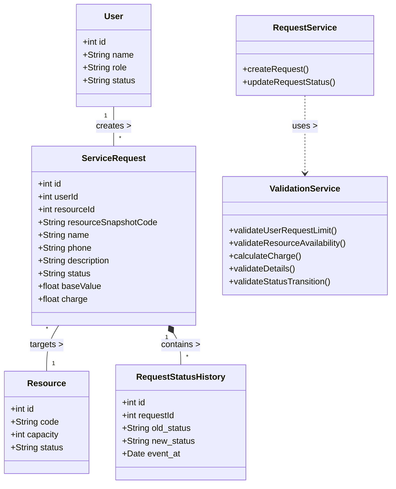

# Requirements Document: Warehouse Dispatch System

## 1. Problem Summary
The Warehouse Dispatch System manages dispatch requests for warehouse resources. It provides a platform with two strict roles: Users (who create and cancel requests) and Administrators (who process and advance requests through their lifecycle).

## 2. Actors
1. **User:** Can submit new dispatch requests, view their own requests, and cancel requests that are currently in the SUBMITTED state.
2. **Administrator:** Can view all transactions and strictly advance requests through the allowed stages: SUBMITTED -> APPROVED/ASSIGNED -> IN_PROGRESS -> COMPLETED.

## 3. Functional Requirements (FR)
| ID | Requirement Description |
|---|---|
| **FR1** | Create and display dispatch requests with unique ID and required service details. |
| **FR2** | Validate active-request limit and eligibility according to BR1/BR2. |
| **FR3** | Display applicable charge/summary and current request status. |
| **FR4** | Validate user, request details and current eligibility before submission. |
| **FR5** | Create unique SUBMITTED request; save snapshot; allocate/reference resource if applicable; record history. |
| **FR6** | Display logged-in user own requests and details. |
| **FR7** | Allow Administrator to move request only to next valid status. |
| **FR8** | Allow eligible cancellation and release resource once. |
| **FR9** | Show clear error for invalid input, unauthorised access or invalid status change. |
| **FR10** | Store users, requests/resources and status history in a persistent database. |

## 4. Non-Functional Requirements (NFR)
1. **Reliability (No partial transaction):** If any check fails, no partial balance/stock/capacity update or record is created. Atomic execution is required.
2. **Persistence:** Data survives application restart via local database storage.
3. **Maintainability:** Separate UI (HTML/JS), business logic (Services), and data access layers.
4. **Usability:** Clear error messages for validation failures on the UI.
5. **Security:** Role and ownership checks to ensure users only see/cancel their own items.

## 5. Business Rules (BR)
| ID | Business Rule |
|---|---|
| **BR1** | At most 5 active requests of this type. A sixth active request must be rejected. |
| **BR2** | A dispatch request can be submitted only when the user and requested service/resource are active and eligible. |
| **BR3** | Save submitted details and service parameters in the request so later master-data changes do not alter historical records (Snapshot). |
| **BR4** | Service charge = Rs.50 below a base value of Rs.1,000 and Rs.0 at Rs.1,000 or above. |
| **BR5** | Name cannot be blank. Phone must contain exactly 10 digits. Required description/reference fields must be present and valid. |
| **BR6** | If ANY validation fails, create NO accepted request and make NO resource/status change. |
| **BR7** | Create one SUBMITTED request, save details, allocate resource, and record history atomically. |
| **BR8** | Only: SUBMITTED -> APPROVED/ASSIGNED -> IN_PROGRESS -> COMPLETED. Administrator cannot skip a stage. User may cancel only SUBMITTED requests. |
| **BR9** | Cancellation changes status to CANCELLED and releases any reserved resource exactly ONCE. Repeated cancellation must have no additional effect. |
| **BR10** | User can view/cancel only own requests. Only Administrator can approve/assign/advance request status. |

## 6. Traceability Table
| Requirement ID | UML Element | Implemented Feature | Test ID |
|---|---|---|---|
| FR1 | UC2 / `ServiceRequest` | `POST /api/requests` | T5 |
| FR2 | `ValidationService` | Active/Eligibility Checks | T2, T3 |
| FR3 | `ServiceRequest` | UI Dashboard Rendering | T4 |
| FR4 | `ValidationService` | Details Validation | T6 |
| FR5 | `RequestService` | DB Transaction block | T5, T7, T11 |
| FR6 | UC3 / `User` | `GET /api/requests` filter | T8 |
| FR7 | UC5 / `Admin` | Admin Status Dropdown | T9, T11 |
| FR8 | UC6 / `User` | Cancel Request flow | T10 |
| FR9 | UI / Server | Error Handling Responses | T6, T8 |
| FR10 | Database | SQLite Persistence | T11, T12 |

---

## 7. UML Diagrams

### 7.1 Use Case Diagram
```mermaid
usecaseDiagram
    actor User as "User"
    actor Admin as "Administrator"

    package "Warehouse Dispatch System" {
        usecase UC1 as "Login (Simulated)"
        usecase UC2 as "Create Dispatch Request"
        usecase UC3 as "View Own Requests"
        usecase UC4 as "View All Transactions"
        usecase UC5 as "Advance Request Status"
        usecase UC6 as "Cancel SUBMITTED Request"
    }

    User --> UC1
    User --> UC2
    User --> UC3
    User --> UC6

    Admin --> UC1
    Admin --> UC4
    Admin --> UC5
```

### 7.2 Class Diagram

